# Análisis de Estrategia de Persistencia — Spa Cielo

Fecha: 2026-10-09  
Fuente: `03_resultados/01_requirements_analysis.md`, `03_resultados/03_architecture_options.md`  
Arquitectura objetivo: **Monolito Modular (Alternativa A)** con preparación para módulos desplegables

---

## Perfil Transaccional y Analítico

### Patrones de Acceso (derivados de RF/RNF)

| Patrón | Frecuencia | Latencia objetivo | Consistencia | Entidades involucradas |
|--------|------------|-------------------|--------------|------------------------|
| **Reserva web** | ~20/hora (pico 40) | <500ms | **Fuerte** (evitar doble booking) | Booking, Resource (cama+trabajadora), Client, Payment |
| **Check-in presencial** | ~15/hora | <300ms | **Fuerte** | Booking, Resource, Client |
| **Validación pago QR** | ~15/hora | <2s (humana) | **Fuerte** (dinero + recurso) | Payment, Booking, Resource |
| **Cambio estado recurso** | ~30/hora | <3s (CA-001) | **Fuerte** | Resource (cama/trabajadora) |
| **Consulta disponibilidad** | ~100/hora | <200ms | Eventual aceptable | Resource, Booking (vista) |
| **Reportes superusuario** | ~5/día | <2s | Eventual | Agregaciones multi-entidad |
| **Auditoría / Trazabilidad** | Escritura: cada tx crítica | Async | Fuerte (inmutable) | AuditLog, todas las entidades |
| **Gestión clientes/usuarios** | Baja | <500ms | Fuerte | User, Client, Role |
| **Inventario básico** | ~10/hora | <500ms | Fuerte | Product, StockMovement |

### Volumen Estimado (RNF-001, RNF-004, RNF-011)

| Métrica | Inicial | Pico (2x) | 10x (eval) |
|---------|---------|-----------|------------|
| Transacciones negocio/hora | 50 | 100 | 500 |
| Escrituras DB/hora (est. 5-10 SQL/tx) | 250-500 | 500-1000 | 2500-5000 |
| Lecturas DB/hora | ~2000 | ~4000 | ~20000 |
| Tamaño DB año 1 | ~500 MB | — | ~5 GB |
| Tamaño DB año 3 (10x) | — | — | ~50 GB |

**Conclusión**: Volumen **bajo-moderado**. Single-node PostgreSQL/MySQL sobra. No requiere sharding, particionamiento, ni réplicas de lectura dedicadas en MVP.

---

## Requisitos Críticos de Persistencia (Trazabilidad RF/RNF)

| Req | Exigencia | Implicación BD |
|-----|-----------|----------------|
| RNF-005, RNF-020 | Evitar doble asignación cama/trabajadora | **Locks a nivel fila**, transacciones ACID, aislamiento `READ COMMITTED` o `REPEATABLE READ` |
| RNF-021 | Fronteras transaccionales dinero + inventario | **Transacciones multi-tabla** atómicas (Booking + Payment + Resource en 1 TX) |
| RNF-022 | Idempotencia ante reintentos | **Tabla deduplicación** (clave idempotencia + hash request) o constraints únicos |
| RF-015, RNF-030+ | Auditoría inmutable operaciones críticas | **Tabla append-only** (event store ligero) o triggers + tabla `audit_log` |
| RNF-040, RNF-043 | Backup diario, 99.8% disponibilidad | **Point-in-time recovery (PITR)**, réplica standby, RPO/RTO definidos |
| RNF-010, RNF-012 | Multi-sucursal futuro, recursos dinámicos | **Columna `branch_id` + RLS** desde día 1, tablas de catálogo parametrizables |
| RNF-060, RNF-061 | Linux, contenedorizable | Imagen oficial Docker, sin dependencias OS-specific |

---

## Comparación de Motores Candidatos

### Criterios de Evaluación

| Criterio | Peso | Descripción |
|----------|------|-------------|
| **Consistencia ACID** | 25% | Transacciones multi-tabla, locks, aislamiento |
| **Concurrencia (locks, MVCC)** | 20% | Control condiciones de carrera recursos finitos |
| **Auditoría / Temporalidad** | 15% | Soporte nativo o fácil para audit log inmutable |
| **Recuperación (PITR, backup)** | 15% | Point-in-time recovery, réplica, RPO/RTO |
| **Operacionalidad (Docker, Linux, tooling)** | 10% | Facilidad despliegue, monitoreo, mantenimiento |
| **Escalabilidad vertical / read-replica** | 10% | Crecimiento a 500 tx/h, réplicas lectura |
| **Costo (licencia, hosting, expertise)** | 5% | Total cost of ownership |

Puntuación: 1 (malo) a 5 (excelente).

---

### Candidato 1: PostgreSQL 16+

| Criterio | Score | Justificación |
|----------|-------|---------------|
| Consistencia ACID | 5 | Estándar oro. Serializable, advisory locks, constraint triggers |
| Concurrencia | 5 | MVCC maduro, `SELECT FOR UPDATE`, `SKIP LOCKED`, advisory locks para recursos finitos |
| Auditoría | 5 | `pg_audit`, triggers, temporal tables (extensión), event triggers, JSONB para payload |
| Recuperación | 5 | WAL + PITR nativo, `pg_basebackup`, réplicas streaming/síncronas, `pgBackRest` |
| Operacionalidad | 5 | Imagen oficial Docker, `pgAdmin`, `pg_stat_statements`, amplio expertise |
| Escalabilidad | 4 | Vertical fuerte, read replicas nativas, partitioning nativo, Citus para scale-out futuro |
| Costo | 5 | Open source, zero licencia, hosting managed barato (RDS, CloudSQL, Neon, Supabase) |
| **Total Ponderado** | **4.90** | |

**Ventajas específicas Spa Cielo**:
- `SELECT FOR UPDATE OF cama, trabajadora SKIP LOCKED` → asignación atómica sin deadlocks
- Advisory locks (`pg_advisory_xact_lock`) para lógica de negocio compleja sin bloquear tablas
- JSONB para `app_config`, payloads QR, auditoría flexible
- RLS (Row Level Security) nativo para multi-sucursal día 1
- `pg_cron` para job limpieza reservas "Pendiente" expiradas

---

### Candidato 2: MySQL 8.0+ (InnoDB)

| Criterio | Score | Justificación |
|----------|-------|---------------|
| Consistencia ACID | 5 | Completo, transacciones multi-tabla, savepoints |
| Concurrencia | 4 | MVCC, `SELECT FOR UPDATE`, `SKIP LOCKED` (8.0+), sin advisory locks nativos |
| Auditoría | 3 | Triggers manuales, sin `pg_audit` equivalente nativo; binlog para CDC |
| Recuperación | 4 | Binlog + PITR, réplicas GTID, tools: `xtrabackup`, `mydumper` |
| Operacionalidad | 5 | Docker oficial, amplio expertise, `MySQL Shell`, `sys` schema |
| Escalabilidad | 4 | Vertical, read replicas, sharding manual (Vitess/ProxySQL) |
| Costo | 5 | Open source, hosting managed barato (RDS, CloudSQL, PlanetScale) |
| **Total Ponderado** | **4.30** | |

**Gaps vs PostgreSQL**:
- Sin advisory locks → más complejo implementar locks de negocio sin contención tablas
- Auditoría más manual (triggers por tabla vs `pg_audit` global)
- RLS no nativo (simulable con vistas + security definer, menos robusto)
- JSON menos potente (sin indexing GIN nativo tan maduro)

---

### Candidato 3: SQL Server 2022 (Express / Standard / Azure SQL)

| Criterio | Score | Justificación |
|----------|-------|---------------|
| Consistencia ACID | 5 | Completo, snapshot isolation, memory-optimized tables |
| Concurrencia | 4 | MVCC (RCSI), `SELECT ... WITH (UPDLOCK, HOLDLOCK)`, sin advisory locks |
| Auditoría | 4 | **Temporal Tables** nativas (system-versioned), Change Data Capture, SQL Audit |
| Recuperación | 5 | Backup nativo, Always On AG, PITR, Azure SQL managed backup |
| Operacionalidad | 3 | Docker (solo Linux reciente), tooling Windows-centrico (SSMS), licensing complejo |
| Escalabilidad | 4 | Vertical, read replicas (AG), partitioning, hyperscale (Azure SQL) |
| Costo | 2 | **Licencia Standard/Core cara**; Express limitado (10GB, 1 socket, 1GB RAM). Azure SQL pay-per-use |
| **Total Ponderado** | **3.85** | |

**Solo viable si**: Organización ya tiene licencias SQL Server + expertise .NET + Windows containers. No es el caso.

---

### Candidato 4: CockroachDB v24+ (SQL Distribuido)

| Criterio | Score | Justificación |
|----------|-------|---------------|
| Consistencia ACID | 5 | **Serializabilidad estricta** (stronger que PG), transacciones distribuidas |
| Concurrencia | 5 | MVCC, locks optimistas, retry automático, `SELECT FOR UPDATE` |
| Auditoría | 3 | Changefeeds (CDC), sin temporal tables nativas; audit manual |
| Recuperación | 4 | Replicación 3x automática, PITR, survivability multi-zone |
| Operacionalidad | 2 | Complejo: cluster 3+ nodos, certificados TLS, debugging distribuido |
| Escalabilidad | 5 | **Scale-out horizontal nativo**, geo-partitioning |
| Costo | 2 | **3 nodos mínimo** (infra 3x), licensing enterprise para features avanzadas |
| **Total Ponderado** | **3.70** | |

**Overkill para Spa Cielo**: Complejidad operativa alta para 50 tx/h. Solo si multi-región activo-activo desde día 1.

---

### Candidato 5: MongoDB 7+ (Documento + Transacciones Multi-Doc)

| Criterio | Score | Justificación |
|----------|-------|---------------|
| Consistencia ACID | 3 | Transacciones multi-doc desde 4.0, pero **no serializable por defecto**; read/write concerns complejos |
| Concurrencia | 2 | Lock a nivel colección (mejor en WiredTiger), sin `SELECT FOR UPDATE` equivalente; optimista manual |
| Auditoría | 3 | Change Streams (CDC), triggers (Atlas), sin temporalidad nativa |
| Recuperación | 3 | Oplog + PITR (Atlas), backup manual en self-hosted |
| Operacionalidad | 4 | Docker, Atlas managed, Compass GUI |
| Escalabilidad | 4 | Sharding nativo, read replicas |
| Costo | 3 | Atlas gratis tier bajo, self-hosted ops moderado |
| **Total Ponderado** | **3.05** | |

**No recomendado**: Consistencia transaccional más débil, modelo relacional encaja mejor (Booking ↔ Resource ↔ Payment ↔ Client), joins frecuentes.

---

### Candidato 6: SQLite (Solo para Comparación - Descarte)

| Criterio | Score | Justificación |
|----------|-------|---------------|
| Consistencia ACID | 4 | Serializabile, pero **solo 1 escritor** (file lock) |
| Concurrencia | 1 | **No concurrencia escritora** — inaceptable para web + recepción simultánea |
| Auditoría | 2 | Triggers manuales |
| Recuperación | 2 | Backup file copy, sin PITR nativo, sin réplica |
| Operacionalidad | 5 | Archivo único, zero config, Docker trivial |
| Escalabilidad | 1 | No escala escritura, no red |
| Costo | 5 | Zero |
| **Total Ponderado** | **2.35** | |

**Descartado**: No soporta concurrencia escritora (RNF-005, RNF-020).

---

## Matriz Resumen

| Motor | ACID (25%) | Concurrencia (20%) | Auditoría (15%) | Recuperación (15%) | Ops (10%) | Escala (10%) | Costo (5%) | **Total** | Veredicto |
|-------|------------|-------------------|-----------------|-------------------|-----------|--------------|------------|-----------|-----------|
| **PostgreSQL 16+** | **5** | **5** | **5** | **5** | **5** | 4 | **5** | **4.90** | ✅ **Recomendado** |
| MySQL 8.0+ | 5 | 4 | 3 | 4 | 5 | 4 | 5 | 4.30 | Alternativa válida |
| SQL Server 2022 | 5 | 4 | 4 | 5 | 3 | 4 | 2 | 3.85 | Solo si stack Microsoft |
| CockroachDB | 5 | 5 | 3 | 4 | 2 | **5** | 2 | 3.70 | Overkill |
| MongoDB 7+ | 3 | 2 | 3 | 3 | 4 | 4 | 3 | 3.05 | Modelo inadecuado |
| SQLite | 4 | 1 | 2 | 2 | 5 | 1 | 5 | 2.35 | ❌ No concurrencia |

---

## Recomendación: **PostgreSQL 16+**

### Justificación Trazable a RF/RNF

| Driver | Decisión PG | RF/RNF Cubiertos |
|--------|-------------|------------------|
| D1: Integridad recursos finitos | `SELECT FOR UPDATE SKIP LOCKED` + advisory locks | RNF-005, RNF-020, RN-001, RN-003, RN-004 |
| D2: Transaccionalidad pagos | TX multi-tabla atómica (Booking+Payment+Resource) | RNF-021, RF-004, RN-002 |
| D3: Idempotencia | Constraint único `(idempotency_key, scope)` + partial index | RNF-022, RF-008 |
| D5: Auditoría | `pg_audit` + tabla `audit_log` append-only + triggers | RF-015, RNF-030+ |
| D6: Config sin redeploy | Tabla `app_config` (clave, valor JSONB, updated_at) + cache TTL | RF-016, RN-003 |
| D8: Multi-sucursal | `branch_id` en todas tablas + **RLS nativo** | RNF-010, RNF-011, RNF-012 |
| D4: Tiempo real | `LISTEN/NOTIFY` + SSE desde app (sin polling BD) | CA-001, RN-003, RN-005 |
| RNF-040/043: HA + Backup | WAL-G / pgBackRest + réplica streaming sincrónica (RPO=0) | RNF-040, RNF-041, RNF-042, RNF-043 |
| RNF-060/061/062: Docker/Linux | Imagen oficial `postgres:16-alpine`, healthcheck, init scripts | RNF-060, RNF-061, RNF-062 |

---

## Esquema Lógico Preliminar (Entidades Core)

```mermaid
erDiagram
    BRANCH ||--o{ RESOURCE : "tiene"
    BRANCH ||--o{ "USER" : "pertenece"
    BRANCH ||--o{ CLIENT : "atiende"
    BRANCH ||--o{ BOOKING : "ubicacion"
    BRANCH ||--o{ PRODUCT : "stock"
    
    RESOURCE {
        uuid id PK
        uuid branch_id FK
        enum type "cama|trabajadora"
        string code "C1-T10"
        enum status "libre|ocupada|mantenimiento"
        int version "optimistic lock"
        jsonb metadata
    }
    
    "USER" {
        uuid id PK
        uuid branch_id FK
        string email UK
        string password_hash
        enum role "superusuario|secretaria|trabajadora|cliente"
        boolean active
    }
    
    CLIENT {
        uuid id PK
        uuid branch_id FK
        string document UK "DNI/pasaporte"
        string name
        string phone
        string email
        jsonb preferences
    }
    
    BOOKING {
        uuid id PK
        uuid branch_id FK
        uuid client_id FK
        uuid resource_cama_id FK
        uuid resource_trabajadora_id FK
        uuid service_id FK
        timestamp start_at
        timestamp end_at
        enum status "pendiente|confirmada|en_curso|finalizada|cancelada|expirada"
        string idempotency_key UK "parcial"
        jsonb metadata
    }
    
    PAYMENT {
        uuid id PK
        uuid booking_id FK "1:1"
        decimal amount
        string currency
        enum method "qr|efectivo|tarjeta"
        enum status "pendiente|verificado|rechazado|reembolsado"
        string qr_payload
        uuid verified_by FK "secretaria"
        timestamp verified_at
        string idempotency_key UK
    }
    
    SERVICE {
        uuid id PK
        uuid branch_id FK
        string name
        int duration_min
        decimal price
        boolean active
    }
    
    PRODUCT {
        uuid id PK
        uuid branch_id FK
        string sku UK
        string name
        int stock_qty
        int min_stock
    }
    
    STOCK_MOVEMENT {
        uuid id PK
        uuid branch_id FK
        uuid product_id FK
        enum type "entrada|salida|ajuste|transferencia"
        int qty
        uuid ref_booking_id FK "nullable"
        string reason
    }
    
    AUDIT_LOG {
        bigserial id PK
        timestamp created_at
        uuid actor_id FK "nullable"
        string entity_type
        uuid entity_id
        enum action "create|update|delete|state_change"
        jsonb old_value
        jsonb new_value
        string correlation_id "trace request"
    }
    
    APP_CONFIG {
        string key PK
        jsonb value
        string description
        timestamp updated_at
        uuid updated_by FK
    }
    
    IDEMPOTENCY_KEY {
        string key PK "scope:key"
        string scope "booking|payment|checkin"
        jsonb request_hash
        jsonb response
        timestamp created_at
        timestamp expires_at
    }
```



### Índices Críticos (Performance + Integridad)

```sql
-- Disponibilidad tiempo real (CA-001 <3s)
CREATE INDEX idx_resource_branch_status_type 
  ON resource(branch_id, status, type) 
  WHERE status IN ('libre', 'ocupada');

-- Booking activo por recurso (evitar doble asignación)
CREATE UNIQUE INDEX uq_booking_active_resource_cama
  ON booking(resource_cama_id) 
  WHERE status IN ('pendiente', 'confirmada', 'en_curso');

CREATE UNIQUE INDEX uq_booking_active_resource_trabajadora
  ON booking(resource_trabajadora_id) 
  WHERE status IN ('pendiente', 'confirmada', 'en_curso');

-- Idempotencia
CREATE UNIQUE INDEX uq_idempotency_key 
  ON idempotency_key(key);

-- Auditoría consultas frecuentes
CREATE INDEX idx_audit_entity ON audit_log(entity_type, entity_id);
CREATE INDEX idx_audit_actor_time ON audit_log(actor_id, created_at DESC);
CREATE INDEX idx_audit_correlation ON audit_log(correlation_id);

-- Config lookup
CREATE INDEX idx_app_config_key ON app_config(key);
```

---

## Estrategia de Concurrencia (D1, RNF-020)

### Asignación Atómica Cama + Trabajadora (Patrón Recomendado)

```sql
-- En transacción única (REPEATABLE READ o SERIALIZABLE)
BEGIN ISOLATION LEVEL REPEATABLE READ;

-- 1. Bloquear recursos candidatos (orden determinista por ID para evitar deadlock)
SELECT id FROM resource 
WHERE id IN ($cama_id, $trabajadora_id) 
  AND status = 'libre' 
  AND branch_id = $branch_id
ORDER BY id
FOR UPDATE SKIP LOCKED;

-- 2. Verificar que ambos están libres (rowcount = 2)
-- 3. Marcar ocupados
UPDATE resource SET status = 'ocupada', version = version + 1 
WHERE id IN ($cama_id, $trabajadora_id);

-- 4. Crear booking + payment (estado pendiente)
INSERT INTO booking (...) VALUES (...);
INSERT INTO payment (...) VALUES (...);

-- 5. Registrar auditoría
INSERT INTO audit_log (...) VALUES (...);

COMMIT;
```

**Por qué no optimista**: Recursos son **escasos (6×10)** y contención alta en picos. Pesimista con `SKIP LOCKED` evita retries aplicación y garantiza latencia predecible.

### Expiración Reservas "Pendiente" (Job pg_cron)

```sql
-- Cada 1 minuto
SELECT cron.schedule(
  'expire-pending-bookings',
  '* * * * *',
  $$
  UPDATE booking b
  SET status = 'expirada',
      metadata = jsonb_set(b.metadata, '{expired_at}', to_jsonb(now()))
  FROM payment p
  WHERE b.id = p.booking_id
    AND b.status = 'pendiente'
    AND p.status = 'pendiente'
    AND b.created_at < now() - interval '15 minutes' -- configurable en app_config
    AND p.method = 'qr';
    
  -- Liberar recursos (trigger en booking.status o CTE RETURNING)
  UPDATE resource r
  SET status = 'libre', version = r.version + 1
  FROM booking b
  WHERE r.id IN (b.resource_cama_id, b.resource_trabajadora_id)
    AND b.status = 'expirada'
    AND r.status = 'ocupada';
  $$
);
```

---

## Estrategia de Auditoría (RF-015, D5)

### Enfoque Híbrido: `pg_audit` + Tabla `audit_log` Aplicación

| Qué | Cómo | Por qué |
|-----|------|---------|
| **DDL / Seguridad / Auth** | `pg_audit` (session, object, role) | Nativo, tamper-proof, compliance |
| **Negocio: booking, payment, resource, client** | Trigger `AFTER INSERT/UPDATE/DELETE` → `audit_log` | Contexto negocio (actor, correlation_id, old/new JSONB) |
| **Config / Idempotencia** | Trigger ligero | Trazabilidad cambios parámetros |

```sql
CREATE OR REPLACE FUNCTION audit_trigger_fn() RETURNS trigger AS $$
BEGIN
  IF TG_OP = 'DELETE' THEN
    INSERT INTO audit_log(entity_type, entity_id, action, old_value, correlation_id)
    VALUES (TG_TABLE_NAME, OLD.id, 'delete', to_jsonb(OLD), current_setting('app.correlation_id', true));
    RETURN OLD;
  ELSIF TG_OP = 'UPDATE' THEN
    INSERT INTO audit_log(entity_type, entity_id, action, old_value, new_value, correlation_id)
    VALUES (TG_TABLE_NAME, NEW.id, 'update', to_jsonb(OLD), to_jsonb(NEW), current_setting('app.correlation_id', true));
    RETURN NEW;
  ELSIF TG_OP = 'INSERT' THEN
    INSERT INTO audit_log(entity_type, entity_id, action, new_value, correlation_id)
    VALUES (TG_TABLE_NAME, NEW.id, 'create', to_jsonb(NEW), current_setting('app.correlation_id', true));
    RETURN NEW;
  END IF;
  RETURN NULL;
END;
$$ LANGUAGE plpgsql SECURITY DEFINER;
```

---

## Estrategia de Backup / Recuperación (RNF-040 a RNF-043)

### Requisitos Pendientes (P-05): **Definir RPO/RTO antes de producción**

| Escenario | RPO Objetivo | RTO Objetivo | Estrategia PG |
|-----------|--------------|--------------|---------------|
| **MVP (recomendado)** | **0** (sin pérdida) | **< 15 min** | Réplica streaming **síncrona** (1 standby) + `pgBackRest` full/incremental cada 6h + WAL continuo |
| **Costo optimizado** | **< 5 min** | **< 1 hora** | Réplica **asíncrona** + `pgBackRest` cada 1h + WAL archiving |
| **Managed (RDS/CloudSQL/Neon)** | Configurable | Configurado | Automático (point-in-time restore UI) |

### Implementación MVP (Self-hosted Docker)

```yaml
# docker-compose.yml (extracto)
services:
  pg-primary:
    image: postgres:16-alpine
    command: >
      -c wal_level=replica
      -c max_wal_senders=10
      -c max_replication_slots=10
      -c synchronous_commit=on
      -c synchronous_standby_names='pg-standby'
    volumes:
      - pgdata:/var/lib/postgresql/data
      - ./init.sql:/docker-entrypoint-initdb.d/init.sql
    environment:
      POSTGRES_PASSWORD_FILE: /run/secrets/pg_password
    secrets:
      - pg_password
    healthcheck:
      test: ["CMD-SHELL", "pg_isready -U postgres"]
      interval: 10s
      timeout: 5s
      retries: 5

  pg-standby:
    image: postgres:16-alpine
    command: >
      -c wal_level=replica
      -c hot_standby=on
      -c primary_conninfo='host=pg-primary port=5432 user=replicator password=*** application_name=pg-standby'
      -c promote_trigger_file=/tmp/promote
    volumes:
      - pgdata_standby:/var/lib/postgresql/data
    depends_on:
      pg-primary:
        condition: service_healthy

  pgbackrest:
    image: pgbackrest/pgbackrest:latest
    volumes:
      - pgbackrest-config:/etc/pgbackrest
      - pgbackrest-spool:/var/spool/pgbackrest
      - pgbackrest-repo:/var/lib/pgbackrest
    environment:
      PGBACKREST_CONFIG: /etc/pgbackrest/pgbackrest.conf
    depends_on:
      - pg-primary
```

```ini
# pgbackrest.conf
[global]
repo1-path=/var/lib/pgbackrest
repo1-retention-full=2
repo1-retention-diff=7
log-level-console=info
compress-type=zst

[demo]
pg1-path=/var/lib/postgresql/data
pg1-host=pg-primary
pg1-port=5432
pg1-user=postgres
```

---

## Configuración Externalizada (D6, RF-016)

### Tabla `app_config` (en BD, gestionable por Superusuario)

| Clave | Tipo | Ejemplo | Descripción |
|-------|------|---------|-------------|
| `booking.pending_ttl_minutes` | int | `15` | Expiración reserva pendiente QR |
| `resource.beds_count` | int | `6` | Nº camas activas (dinámico RN-001) |
| `resource.workers_max` | int | `10` | Nº trabajadoras máx (dinámico RN-001) |
| `payment.qr_provider` | string | `"mercadopago"` | Proveedor QR inicial |
| `notification.whatsapp_template_booking` | string | `"template_123"` | Plantilla WhatsApp |
| `report.cache_ttl_seconds` | int | `300` | Cache reportes superusuario |

**Cache en memoria** (aplicación): TTL 60s, invalidación por `LISTEN/NOTIFY` en `UPDATE app_config`.

---

## Migraciones y Versionado

- **Herramienta**: `golang-migrate` / `Flyway` / `EF Core Migrations` / `sqlx-migrate` (según stack backend)
- **Convención**: `V{version}_{descripcion}.sql` (ej: `V1_001_initial_schema.sql`)
- **Entornos**: Dev → Test → Prod (misma secuencia, validar en Test)
- **Rollback**: Scripts `DOWN` obligatorios para cambios destructivos

---

## Decisiones Pendientes (Bloquean Detalle Final)

| # | Decisión | Dueño | Impacto |
|---|----------|-------|---------|
| DB-01 | **RPO/RTO numéricos** | Producto/Técnico | Define réplica sincrónica vs asíncrona, frecuencia backup |
| DB-02 | **Proveedor QR / Webhook vs Polling** | Producto | Define tabla `payment.qr_payload`, `payment.webhook_event_id`, job polling |
| DB-03 | **Multi-sucursal día 1 confirmado** | Producto | Confirma `branch_id` + RLS en todas tablas core |
| DB-04 | **Stack backend (lenguaje/ORM)** | Architect | Define herramienta migraciones, patrones repositorio |

---

## Próximos Pasos

1. **`security-reviewer`** → Revisar identidad, autorización, APIs, secretos, auditoría, fraude, datos, terceros, resiliencia (05_security_review.md)
2. **`devops-architect`** → Evaluar despliegue, contenedores, escalado, observabilidad, backup, CI/CD, **K8s sí/no** (06_infrastructure.md)
3. **`architecture-reviewer`** → Revisión adversarial completa (07_architecture_review.md)
4. **`solution-leader`** → Consolidación + ADR + Plan de pruebas (08_recomendacion_final.md)

---

**Skill utilizado**: `database-evaluation`  
**Agente responsable**: `database-specialist`  
**Estado**: `HUMAN_STATUS: PENDING` — Requiere validación de RPO/RTO (P-05) y proveedor QR (P-04) antes de detallar migraciones finales.