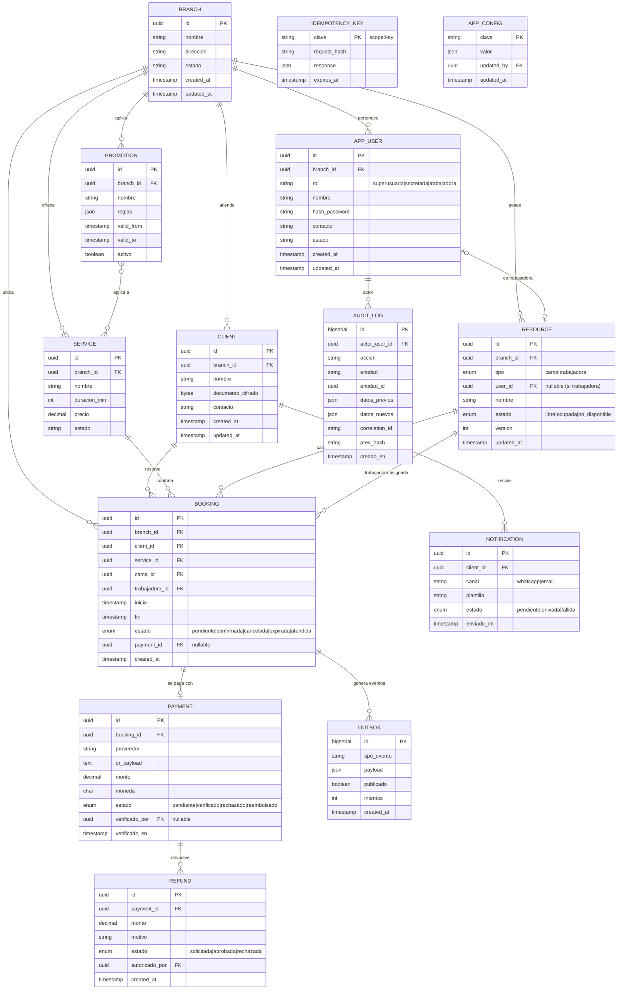

# Paso 03 — Diagrama Entidad-Relación (conceptual)

Sistema: **Spa Cielo**
Skill: `database-schema-designer`
Formato: **Mermaid** (versionable en Git).

---

## 1. Diagrama

> Nota: `PROMOTION }o--o{ SERVICE` es conceptual; en el modelo lógico se resuelve con la
> tabla asociativa `promotion_service`.

---

## 2. Convenciones

- PK = clave primaria; FK = clave foránea; UK = clave única.
- `uuid` para entidades de dominio (evita enumeración, D-07); `bigserial` para
  `outbox` y `audit_log` (alto volumen, append-only).
- Tipos mostrados aquí son **indicativos conceptuales**; se fijan en el diseño físico.

**Estado del paso:** completado.
