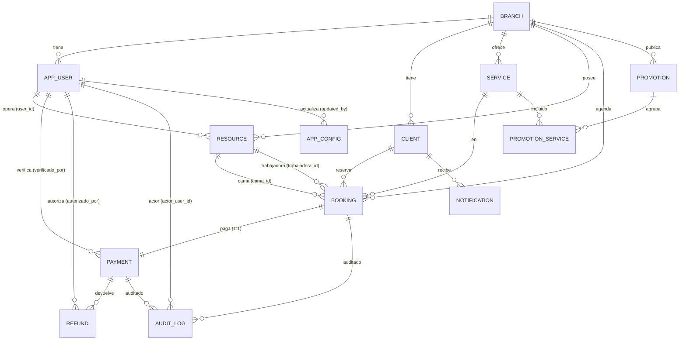

# Paso 18 — Documentación de la base real

Sistema: **Spa Cielo**
Skill: `database-documentation`
Fecha: 2026-10-19
Base: `sistema` @ `localhost:5432`
Motor real: **PostgreSQL 18.3** (x86_64-windows) — cumple "PostgreSQL 16+" (D-08).
Esquemas aplicados: `core`, `auth`, `catalog`, `booking`, `payment`, `support`, `audit`.
Migraciones aplicadas: `V0001`–`V0010` (ver Paso 17).

> Documento generado por **introspección real** (`pg_class`, `pg_constraint`,
> `pg_indexes`, `pg_trigger`, `pg_policies`, `information_schema`) y comparado con
> los artefactos de diseño (Pasos 04–13).

---

## 1. ERD obtenido de la base real

Vistas materializadas (reportes): `booking.mv_ocupacion_diaria`,
`booking.mv_rendimiento_trabajadora`, `payment.mv_ingresos_periodo`.

---

## 2. Diccionario de datos (real)

Tipos abreviados: `ts` = `timestamptz`.

### `core.branch`
| Columna | Tipo | Null | Default |
|---|---|---|---|
| id | uuid | NO | gen_random_uuid() |
| nombre | text | NO | — |
| direccion | text | NO | — |
| estado | text | NO | 'activa' |
| created_at | ts | NO | now() |
| updated_at | ts | NO | now() |

### `core.app_config`
| Columna | Tipo | Null | Default |
|---|---|---|---|
| clave | text | NO | — |
| valor | jsonb | NO | — |
| updated_by | uuid | YES | — |
| updated_at | ts | NO | now() |

### `auth.app_user`
| Columna | Tipo | Null | Default |
|---|---|---|---|
| id | uuid | NO | gen_random_uuid() |
| branch_id | uuid | NO | — |
| rol | text | NO | — |
| nombre | text | NO | — |
| hash_password | text | NO | — |
| contacto | text | YES | — |
| estado | text | NO | 'activo' |
| created_at | ts | NO | now() |
| updated_at | ts | NO | now() |

### `catalog.client`
| Columna | Tipo | Null | Default |
|---|---|---|---|
| id | uuid | NO | gen_random_uuid() |
| branch_id | uuid | NO | — |
| nombre | text | NO | — |
| documento_cifrado | bytea | NO | — |
| documento_hash | text | NO | — |
| contacto | text | YES | — |
| created_at | ts | NO | now() |
| updated_at | ts | NO | now() |

### `catalog.service`
| Columna | Tipo | Null | Default |
|---|---|---|---|
| id | uuid | NO | gen_random_uuid() |
| branch_id | uuid | NO | — |
| nombre | text | NO | — |
| duracion_min | integer | NO | — |
| precio | numeric | NO | — |
| estado | text | NO | 'activo' |
| created_at | ts | NO | now() |
| updated_at | ts | NO | now() |

### `catalog.resource`
| Columna | Tipo | Null | Default |
|---|---|---|---|
| id | uuid | NO | gen_random_uuid() |
| branch_id | uuid | NO | — |
| tipo | text | NO | — |
| user_id | uuid | YES | — |
| nombre | text | NO | — |
| estado | text | NO | 'libre' |
| version | integer | NO | 0 |
| created_at | ts | NO | now() |
| updated_at | ts | NO | now() |

### `catalog.promotion`
| Columna | Tipo | Null | Default |
|---|---|---|---|
| id | uuid | NO | gen_random_uuid() |
| branch_id | uuid | NO | — |
| nombre | text | NO | — |
| reglas | jsonb | NO | '{}' |
| valid_from | ts | NO | — |
| valid_to | ts | NO | — |
| activo | boolean | NO | true |
| created_at | ts | NO | now() |
| updated_at | ts | NO | now() |

### `catalog.promotion_service`
| Columna | Tipo | Null | Default |
|---|---|---|---|
| promotion_id | uuid | NO | — |
| service_id | uuid | NO | — |

### `booking.booking`
| Columna | Tipo | Null | Default |
|---|---|---|---|
| id | uuid | NO | gen_random_uuid() |
| branch_id | uuid | NO | — |
| client_id | uuid | NO | — |
| service_id | uuid | NO | — |
| cama_id | uuid | NO | — |
| trabajadora_id | uuid | NO | — |
| inicio | ts | NO | — |
| fin | ts | NO | — |
| periodo | tstzrange (generada STORED) | YES | — |
| estado | text | NO | 'pendiente' |
| created_at | ts | NO | now() |
| updated_at | ts | NO | now() |
| payment_id | uuid | YES | — |

### `payment.payment`
| Columna | Tipo | Null | Default |
|---|---|---|---|
| id | uuid | NO | gen_random_uuid() |
| booking_id | uuid | NO | — |
| proveedor | text | NO | — |
| qr_payload | text | YES | — |
| monto | numeric | NO | — |
| moneda | char(3) | NO | 'BOB' |
| estado | text | NO | 'pendiente' |
| verificado_por | uuid | YES | — |
| verificado_en | ts | YES | — |
| created_at | ts | NO | now() |
| updated_at | ts | NO | now() |

### `payment.refund`
| Columna | Tipo | Null | Default |
|---|---|---|---|
| id | uuid | NO | gen_random_uuid() |
| payment_id | uuid | NO | — |
| monto | numeric | NO | — |
| motivo | text | YES | — |
| estado | text | NO | 'solicitada' |
| autorizado_por | uuid | YES | — |
| created_at | ts | NO | now() |

### `payment.idempotency_key`
| Columna | Tipo | Null | Default |
|---|---|---|---|
| clave | text | NO | — |
| request_hash | text | NO | — |
| response | jsonb | YES | — |
| expires_at | ts | NO | — |
| created_at | ts | NO | now() |

### `support.notification`
| Columna | Tipo | Null | Default |
|---|---|---|---|
| id | uuid | NO | gen_random_uuid() |
| client_id | uuid | NO | — |
| canal | text | NO | — |
| plantilla | text | NO | — |
| estado | text | NO | 'pendiente' |
| enviado_en | ts | YES | — |
| created_at | ts | NO | now() |

### `support.outbox`
| Columna | Tipo | Null | Default |
|---|---|---|---|
| id | bigint (identity) | NO | — |
| tipo_evento | text | NO | — |
| payload | jsonb | NO | — |
| publicado | boolean | NO | false |
| intentos | integer | NO | 0 |
| created_at | ts | NO | now() |

### `audit.audit_log`
| Columna | Tipo | Null | Default |
|---|---|---|---|
| id | bigint (identity) | NO | — |
| actor_user_id | uuid | YES | — |
| accion | text | NO | — |
| entidad | text | NO | — |
| entidad_id | uuid | YES | — |
| datos_previos | jsonb | YES | — |
| datos_nuevos | jsonb | YES | — |
| correlation_id | text | YES | — |
| prev_hash | text | YES | — |
| creado_en | ts | NO | now() |

---

## 3. Inventario de objetos (real)

### Claves y constraints (notación `contype`: p=PK, f=FK, u=UNIQUE, c=CHECK, x=EXCLUDE)
- **PK:** todas las 15 tablas.
- **UNIQUE:** `uq_branch_nombre`, `uq_user_contacto(branch_id,contacto)`,
  `uq_client_doc(branch_id,documento_hash)`, `uq_service_nombre(branch_id,nombre)`,
  `uq_resource_nombre(branch_id,tipo,nombre)`, `uq_payment_booking(booking_id)`,
  `uq_promotion_nombre(branch_id,nombre)`, `promotion_service_pkey(compuesta)`.
- **EXCLUDE (gist):** `ex_booking_cama`, `ex_booking_trab` (anti-solape, RN-001/003).
- **FK destacadas:** 4×`RESTRICT` en `booking` a branch/client/service/resource;
  `payment→booking RESTRICT`; `refund→payment RESTRICT`; `notification→client RESTRICT`;
  `app_config.updated_by`, `payment.verificado_por`, `refund.autorizado_por`,
  `resource.user_id`, `booking.payment_id` → `SET NULL`; `promotion_service` → `CASCADE`.
- **CHECK:** estados (todos), `ck_booking_periodo(fin>inicio)`, `ck_promotion_vigencia`,
  `duracion_min>0`, `precio>=0`, `monto>=0`, `ck_resource_user`, longitudes máximas.

### Índices: 47 en total
- B-tree compuestos/parciales: `ix_booking_branch_inicio`, `ix_booking_activas`,
  `ix_resource_estado`, `ix_user_branch`, `ix_client_branch`, `ix_service_branch`,
  `ix_booking_cama/trabajadora/client/service`, `ix_payment_estado` (parcial),
  `ix_refund_payment`, `ix_idem_expires`, `ix_notification_pendiente` (parcial),
  `ix_outbox_pending` (parcial).
- GiST: `ex_booking_cama`, `ex_booking_trab`.
- GIN: `gin_promotion_reglas`, `gin_app_config_valor`.
- BRIN: `ix_audit_created_brin`.
- Únicos de vistas materializadas: `ux_mv_ocupacion`, `ux_mv_ingresos`,
  `ux_mv_rendimiento` (permiten `REFRESH ... CONCURRENTLY`).

### Triggers (19 tras V0011): 
`trg_updated_*` (branch, user, client, service, resource, booking, payment, promotion);
`trg_booking_confirm_requires_payment`; `trg_resource_state_on_booking`;
`trg_audit_user`, `trg_audit_booking`, `trg_audit_payment`, `trg_audit_config`
(+ V0011: `trg_audit_client`, `trg_audit_service`, `trg_audit_resource`,
`trg_audit_refund`, `trg_audit_promotion`).

### RLS: 9 tablas con `rowsecurity=true`
`core.branch`, `auth.app_user`, `catalog.{client,service,resource,promotion}`,
`booking.booking`, `payment.{payment,refund}`. Políticas `p_branch_self`, `p_user`,
`p_client`, `p_service`, `p_resource`, `p_promotion`, `p_booking`,
`p_payment` (vía EXISTS booking), `p_refund` (vía EXISTS payment→booking).
Contexto por transacción: `current_setting('app.branch_id', true)::uuid`.

### Roles: `spa_app`, `spa_readonly`, `spa_cron` (sin contraseña en SQL; se asigna fuera).
### Extensiones instaladas: `plpgsql 1.0`, `pgcrypto 1.4`, `btree_gist 1.8`, `pg_trgm 1.6`.
### Seed `core.app_config`: `numero_camas_max`, `numero_trabajadoras_max`,
`ttl_reserva_min`, `moneda`, `capacidad_tx_hora`.

---

## 4. Comparación diseño vs. esquema real

| Artefacto de diseño | Resultado real | Veredicto |
|---|---|---|
| Modelo físico (Paso 07): tipos, PK uuid, `numeric(12,2)`, `text+CHECK`, `timestamptz` | Coincide 1:1 en las 15 tablas | OK |
| Integridad (Paso 08): PK/FK/UNIQUE/CHECK/EXCLUDE, `ON DELETE` | Coincide; EXCLUDE gist activos | OK |
| Índices (Paso 11): 17 índices + 3 MV | Presentes (nombres difieren, semántica igual) | OK |
| Seguridad (Paso 09): roles, RLS, REVOKE auditoría | RLS y REVOKE presentes; faltan `spa_owner`/`spa_backup` | Parcial (DRIFT-01) |
| Auditoría (Paso 10a): triggers en 9 tablas | Triggers solo en 4 tablas | **DRIFT-02** |
| Extensiones (Paso 07 §4): pg_cron, pgaudit | No instaladas/​no disponibles | **DRIFT-03** |
| Índice de cobertura `ix_booking_list (INCLUDE ...)` (Paso 11 §2, opcional) | No creado | DRIFT-04 (menor) |

---

## 5. Detección de drift

| ID | Drift | Severidad | Impacto | Recomendación |
|---|---|---|---|---|
| DRIFT-01 | Roles `spa_owner` y `spa_backup` no creados (el propietario hoy es `postgres`) | Baja | Sin aislamiento de propietario; backup no configurado | Crear en fase DevSecOps (Paso DevOps); fuera del alcance SQL |
| DRIFT-02 | Auditoría por trigger solo en `app_user`, `booking`, `payment`, `app_config`; diseño pedía además `client`, `service`, `resource`, `refund`, `promotion` | **Resuelto (V0011)** | — | Triggers añadidos; 9 tablas auditadas |
| DRIFT-03 | `pg_cron` y `pgaudit` no instalados (no disponibles en este build) | Media | TTL se programa desde la app (D-09); DDL no auditado por pgaudit | Aceptado y documentado; TTL vía Laravel scheduler; evaluar `pgaudit` en despliegue Linux |
| DRIFT-04 | Índice de cobertura `ix_booking_list` (opcional) no creado | Baja | Optimización del listado del día no aplicada | Crear si las pruebas (Paso 19) muestran seq scan en A-03 |
| DRIFT-05 | Nombres de índices/roles difieren de la tabla del Paso 11 (p. ej. `ix_booking_estado`→`ix_booking_activas`) | Informativa | Ninguno (semántica equivalente) | Sin acción; se documenta la nomenclatura real |
| DRIFT-06 | `spa_readonly` sin `BYPASSRLS` (el diseño lo mencionaba para consolidación) | Baja | Reportes multi-sucursal requieren setear `app.branch_id` o rol dedicado | Definir política de consolidación antes de BI |

---

## 6. Conclusión del Paso 18

El esquema real **reproduce el diseño** en estructura, tipos, integridad y RLS.
Los desvíos son de entorno/infra (DRIFT-01/03) o de cobertura de auditoría.
**DRIFT-02 quedó resuelto con `V0011`** (triggers de auditoría en las 9 tablas
críticas). Persisten DRIFT-01/03/04 (infra/opcionales), documentados para la fase
DevSecOps.

**Estado del paso:** completado (drift documentado; DRIFT-02 cerrado).
